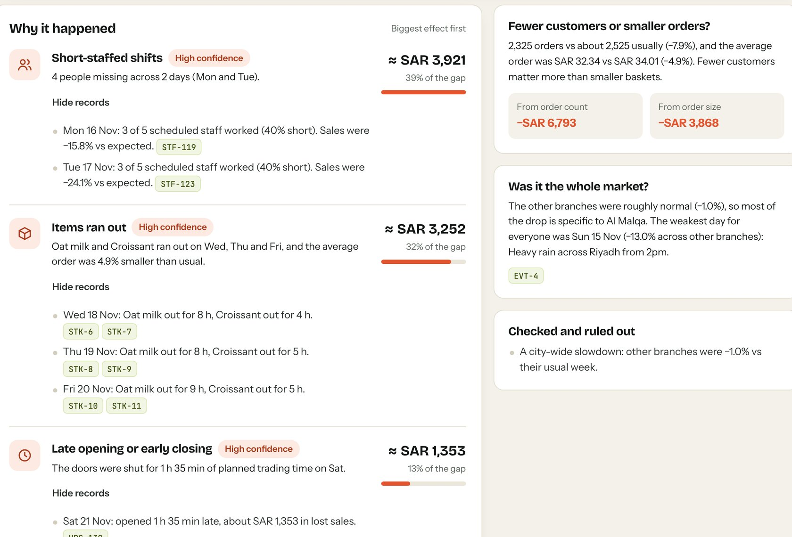

# BranchPulse

**Find out why a branch made less money, with proof.**

🔗 **Live app:** https://branchpulse.vercel.app/#/

## The problem

One branch makes less money this week. The sales report shows the drop, but not the reason. Was it missing staff, an item that ran out, a late opening, or bad weather? Owners end up guessing.

## The solution

BranchPulse reads your sales, staff, stock, opening hours and reviews, then explains the drop in plain English:

> *"Two days were short-staffed, oat milk ran out for three days, and the branch opened 95 minutes late on Saturday."*

Every reason shows the record that proves it, plus a simple fix.

## How it works

## Good to know

- 🔒 Your files stay in your browser. There's no login and no server.
- ✨ The AI write-up is optional and free, using a Google Gemini key.

Built with React, TypeScript and Vite.
