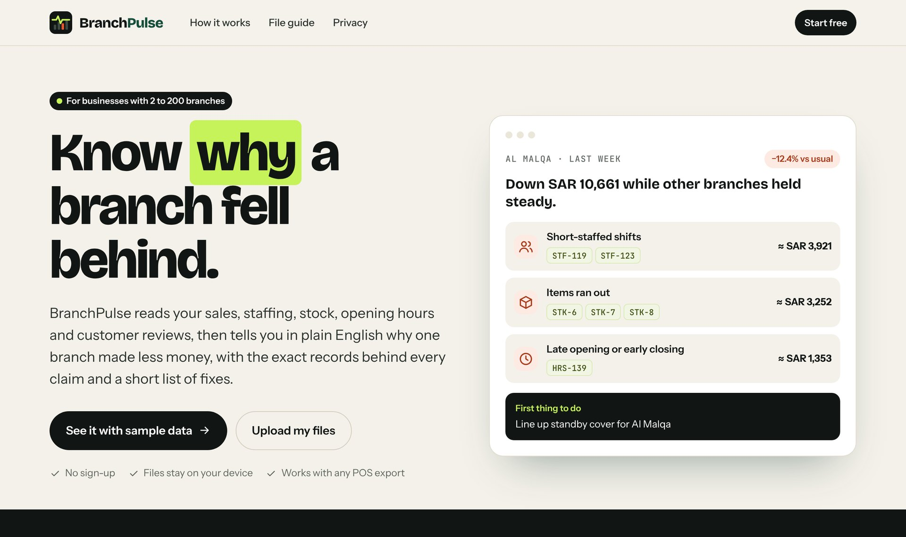
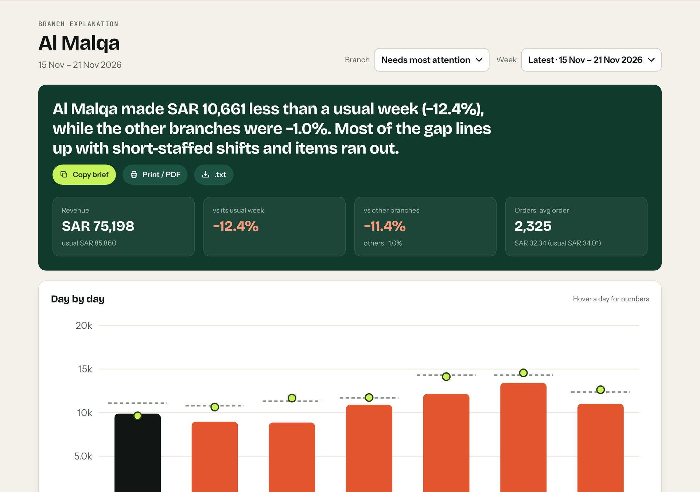
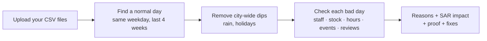
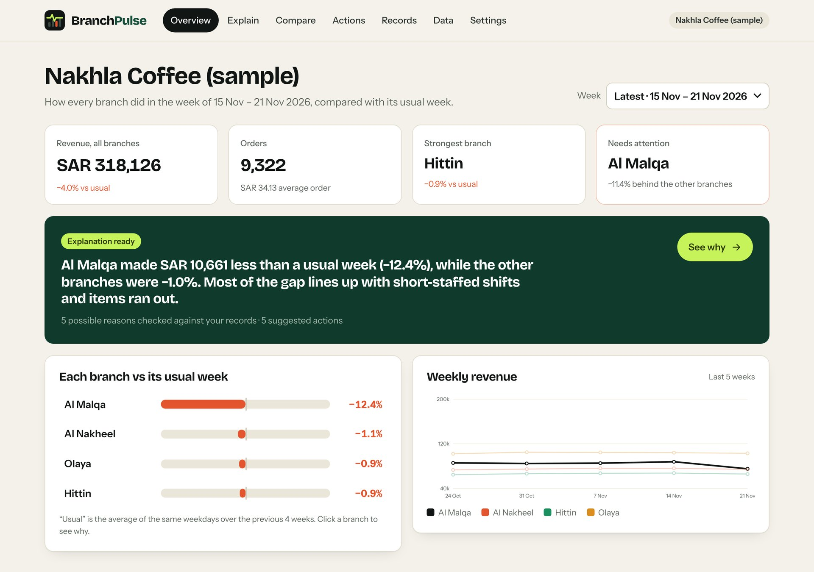

# BranchPulse

**Find out why a branch made less money, with proof.**



## The problem

You run several branches. One week, one branch makes less money than the rest.

The sales report shows the drop but not the reason. Was it missing staff? A popular item that ran out? A late opening? Rain? Unhappy customers? The answers are spread across different systems, so most owners end up guessing.

## The solution

BranchPulse puts your data together and explains the drop in plain English:

> *"Al Malqa made SAR 10,661 less than a usual week. Two days were short-staffed, oat milk ran out for three days, and the branch opened 95 minutes late on Saturday."*

Every reason links to the exact record that proves it, and you get a short list of fixes.



## How it works



1. **Upload files.** Sales is required. Staff, stock, opening hours, reviews and events are optional.
2. **Find "normal".** Each day is compared with the same weekday over the past 4 weeks.
3. **Remove what hit everyone.** If every branch was down on a rainy day, one branch isn't blamed for it.
4. **Look for reasons.** On each bad day it checks for missing staff, items running out, late opening, nearby events and complaints.
5. **Show the answer.** You see the reasons ranked by estimated money lost, each with the record behind it and a fix.


## What's inside

| Page | What it does |
|---|---|
| **Overview** | Every branch at a glance, with the one that needs attention flagged |
| **Explain** | Why a branch dropped: reasons, money lost, proof and fixes |
| **Compare** | Two branches side by side |
| **Actions** | Turn fixes into tasks with an owner and a due date |
| **Records** | Every row from your files, searchable |
| **Data** | Upload files, download templates, try the sample data |



## Private by design

There's no server and no login. Your files stay in your own browser.

## Optional AI write-up (free)

BranchPulse works fully without AI. If you want a ready-to-send message for your team:

1. Get a free key at [Google AI Studio](https://aistudio.google.com/app/apikey).
2. Paste it in **Settings**.
3. On the **Explain** page, press **Write it for me**.

The AI only rewrites what BranchPulse already found, and every record it mentions is checked. If Google's free servers are busy, BranchPulse retries and switches to another free model by itself.

## Try it

Open the app and click **See it with sample data**. It loads a made-up café chain with 4 branches and 5 weeks of data.

## Run on your computer

```bash
npm install
npm run dev
```

## Deploy (free)

1. Sign in to [vercel.com](https://vercel.com) with GitHub.
2. Click **Add New → Project** and import this repo.
3. Click **Deploy**. Nothing else needs to be set.

Built with React, TypeScript and Vite.
